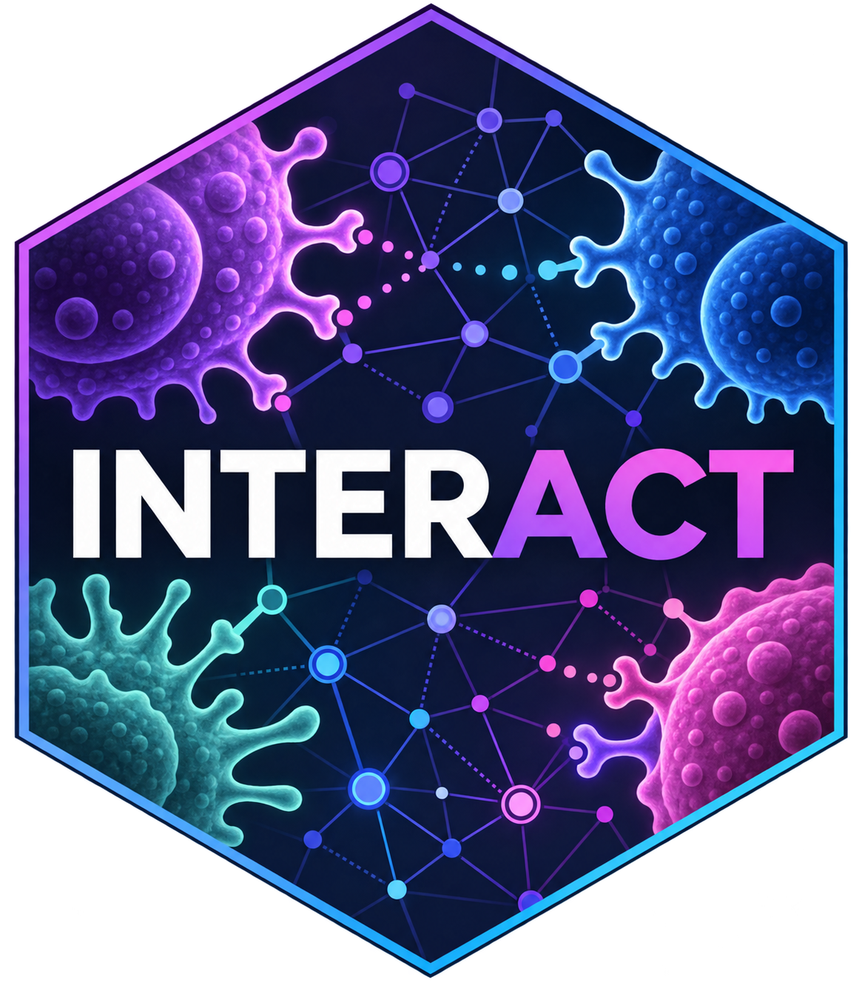

# INTERACT 

**INTERACT** (**INTE**grative **A**nalysis for **C**ellular and **T**umor interactions) is an R package for inferring and prioritizing cell-cell communication networks within the tumor microenvironment. By integrating transcriptomic profiles across distinct cell populations with downstream pathway activity, lineage-constrained phenotypic programs, and optional tumor somatic alterations, INTERACT computes a multi-layered communication score for candidate ligand-receptor pairs.

## Motivation

Standard cell-cell communication inference methods estimate signaling potential primarily from the co-expression of ligand and receptor mRNA transcripts. While co-expression provides an essential baseline, transcript abundance alone does not indicate whether a signal is functionally received by the target cell or whether tumor-specific genomic alterations are reshaping the signaling axis.

INTERACT extends co-expression analysis by integrating three complementary layers of biological evidence:

1. **Transcriptional Co-expression ($S_{\text{base}}$)**: Quantifies baseline signaling potential from sender ligand and receiver receptor expression across single-cell pseudobulk or bulk RNA-seq profiles.
2. **Downstream Functional Activity ($W_{\text{pathway}}$ and $W_{\text{program}}$)**: Evaluates whether canonical intracellular signaling pathways and lineage-matched phenotypic gene programs associated with the engaged receptor and ligand are active in the communicating cells.
3. **Tumor Genomic Context ($W_{\text{genomic}}$)**: When tumor somatic single-nucleotide variants (SNVs) and copy number variants (CNVs) are provided, INTERACT adjusts tumor-involved interactions to reflect copy number amplifications, single-copy losses, activating or loss-of-function mutations, and homozygous deletions.

Importantly, genomic alterations are treated as **context-dependent modifiers rather than prerequisites**. Immune-to-immune interactions and diploid, wild-type tumor interactions have a neutral genomic modifier ($W_{\text{genomic}} = 0$) and are prioritized on the strength of their transcriptional expression and functional pathway/program engagement.

---

## Scoring Methodology

INTERACT operates additively in log space. For a given sample, sender population, receiver population, and ligand-receptor pair, the integrated communication score ($S_{\text{final}}$) is defined as:

$$S_{\text{final}} = S_{\text{base}} + W_{\text{pathway}} + W_{\text{program}} + W_{\text{genomic}}$$

### 1. Baseline Expression Score ($S_{\text{base}}$)

$$S_{\text{base}} = E_{\text{ligand}} + E_{\text{receptor}}$$

where $E_{\text{ligand}}$ and $E_{\text{receptor}}$ represent log-scale expression values (e.g., $\log_2(\text{CPM} + 1)$) in the sender and receiver populations, respectively. Because the inputs are log-transformed, their sum corresponds to the log of the product of linear transcript abundances.

- **Minimum Expression Threshold**: Both the ligand and receptor must meet a minimum expression threshold (`min.expression`, default = $1.0$) for an interaction to be evaluated.
- **Multimeric Complexes**: Heteromeric ligands and receptors (e.g., `IL6R_IL6ST`) are evaluated using the minimum expression across all constituent subunits, reflecting the stoichiometric limiting component.

### 2. Downstream Pathway Weight ($W_{\text{pathway}}$)

Intracellular pathway activity in each receiver population is inferred using [PROGENy](https://saezlab.github.io/progeny/) across 14 canonical signaling pathways. Each receptor is mapped to its corresponding downstream pathway(s), and $P_{\text{receiver}}$ is defined as the maximum activity score among pathways linked to that receptor. To prevent extreme outliers from dominating the score, pathway activity is scaled and bounded using a hyperbolic tangent function:

$$W_{\text{pathway}} = \beta_{\text{pathway}} \cdot \tanh\left(\frac{P_{\text{receiver}}}{c_{\text{pathway}}}\right)$$

- $\beta_{\text{pathway}}$ (default = $5$) sets the maximum magnitude (in $\log_2$ expression units) that unilateral receiver pathway activation can add to or subtract from $S_{\text{base}}$.
- $c_{\text{pathway}}$ (`scale.pathways`) is a data-driven normalization constant automatically calibrated as half of the 95th percentile ($Q_{0.95} / 2$) of absolute pathway scores across the cohort. Because $\tanh(2) \approx 0.964$, this maps 95% of biological variation smoothly onto the responsive $(-0.96, +0.96)$ region of $\tanh$ while saturating extreme outliers at $\pm 1.0$.

### 3. Phenotypic Program Weight ($W_{\text{program}}$)

Broader cellular states and biological processes are quantified per cell population using single-sample Gene Set Enrichment Analysis (ssGSEA) across curated gene sets from ImmPort, Reactome, and Gene Ontology. Gene sets are filtered by cell lineage compatibility so that lineage-restricted programs (e.g., TCR signaling or BCR signaling) are evaluated only in appropriate populations. The sender program score ($G_{\text{sender}}$) and receiver program score ($G_{\text{receiver}}$) are bounded jointly:

$$W_{\text{program}} = \beta_{\text{program}} \cdot \tanh\left(\frac{G_{\text{sender}} + G_{\text{receiver}}}{c_{\text{program}}}\right)$$

- $\beta_{\text{program}}$ (default = $8$) sets the maximum magnitude for bilateral program enrichment across the sender and receiver compartments (up to $\sim 4$ $\log_2$ units per compartment).
- $c_{\text{program}}$ (`scale.programs`) is automatically calibrated as $Q_{0.95} / 2$ of the combined program scores across the cohort.

### 4. Tumor Genomic Modifier ($W_{\text{genomic}}$)

When `snv.matrix` and/or `cnv.matrix` are supplied, genomic alterations are evaluated for interactions where the sender and/or receiver is the tumor population (non-tumor populations default to wild-type $\text{SNV} = 0$ and diploid $\text{CNV} = 2.0$):

1. **Homozygous Deletion Filter**: If the tumor exhibits a homozygous deletion ($\text{CNV} < 0.5$) in any subunit of the ligand (when tumor is sender) or receptor (when tumor is receiver), the interaction edge is removed prior to scoring.
2. **Additive Genomic Weight**: For retained interactions, SNV and CNV effects are computed as:

$$W_{\text{genomic,sender}} = \text{SNV}_{\text{sender}} + \tanh\left[\log_2\left(\frac{\max(\text{CNV}_{\text{sender}}, 0.5)}{2.0}\right)\right]$$

$$W_{\text{genomic,receiver}} = \text{SNV}_{\text{receiver}} + \tanh\left[\log_2\left(\frac{\max(\text{CNV}_{\text{receiver}}, 0.5)}{2.0}\right)\right]$$

$$W_{\text{genomic}} = W_{\text{genomic,sender}} + W_{\text{genomic,receiver}}$$

where somatic SNVs are encoded directionally ($+1$ for activating or expression-enhancing alterations, $-1$ for repressive or loss-of-function alterations, and $0$ for wild type) and copy numbers are evaluated relative to the diploid baseline of $2.0$.

### Underlying Assumptions and Scope

- **Mass-Action Approximation**: Baseline interaction potential assumes that signaling likelihood scales with the availability of ligand and receptor transcripts ($E_{\text{ligand}} + E_{\text{receptor}}$).
- **Transcriptomic Proxy**: mRNA expression serves as a surrogate for surface protein abundance, and transcriptional footprint signatures (PROGENy and ssGSEA) serve as surrogates for downstream signaling engagement.
- **Microenvironmental Co-localization**: Sender and receiver populations profiled within the same sample are assumed to be capable of paracrine or juxtacrine communication within the tissue compartment.

---

## Integrated Knowledge Bases

INTERACT integrates three curated knowledge bases to support its functional scoring:

1. [**OmniPath database**](https://omnipathdb.org/): Provides the reference intercellular communication network (`intercell_network(high_confidence = TRUE)`). INTERACT filters this database via `filter_intercell_network()` to retain only curated interactions meeting four criteria:
   - **Transmitter topology**: The ligand/sender molecule must be secreted (`sec`), plasma membrane transmembrane (`pmtm`), or plasma membrane peripheral (`pmp`), capturing both soluble paracrine factors and cell-surface contact ligands.
   - **Receiver topology**: The receptor/target molecule must be a plasma membrane transmembrane (`pmtm`) protein capable of transducing extracellular signals across the cell membrane.
   - **Literature support**: Each interaction must be supported by at least two independent primary literature references (`min_references = 2`).
   - **Subunit mappability**: All required gene symbols—including every constituent subunit of heteromeric complexes (`COMPLEX:`)—must be measured in the input expression matrices.

2. [**PROGENy pathways**](https://saezlab.github.io/progeny/): Infers the activity of 14 canonical intracellular signaling pathways (e.g., `JAK-STAT`, `NFkB`, `TGFb`, `TNFa`, `MAPK`, `PI3K`) from consensus downstream target gene footprints. INTERACT maps these pathways to their upstream initiating receptors so that interactions are up- or down-weighted according to downstream pathway activity in the receiving cell.

3. **Curated Phenotypic Gene Sets**: Quantifies broader cellular states (e.g., `"T-cell Activation"`, `"Phagocytosis"`, `"Antigen Processing and Presentation"`) per cell population using ssGSEA. By default, INTERACT uses curated signatures from [ImmPort](https://www.immport.org/shared/genelists), [Reactome](https://reactome.org/), and [Gene Ontology](https://geneontology.org/) filtered for cell-lineage compatibility.

---

## Multi-Channel Graph Autoencoder & Edge Attribution

Beyond pairwise interaction scoring, INTERACT includes an optional deep learning module built on PyTorch Geometric to analyze patient-level communication architecture across the cohort:

1. **Multi-Channel Graph Representation**: Each patient's microenvironment is represented as a directed graph where nodes are cell populations and edges carry a 5-channel feature vector decomposing the interaction into `[RNA, Pathway, Program, SNV, CNV]` contributions, paired with global tumor mutational burden and aneuploidy context.
2. **Relational Graph Autoencoder (`GINEConv`)**: A Graph Isomorphism Network with Edge features encodes each patient's signaling graph into a low-dimensional latent representation (`embeddings`), trained via link reconstruction and feature alignment objectives.
3. **Patient Subtyping**: Low-dimensional embeddings are projected into 2D space via UMAP (`n_neighbors = 15`, `min_dist = 0.1`), and unsupervised patient clusters are identified using Louvain community detection on a mutual undirected shared nearest-neighbor (SNN) graph.
4. **Path-Integrated Gradients Attribution**: Using `RunInteractEdgeGradients()`, INTERACT computes axiomatic Path-Integrated Gradients along a straight-line path from a zero-edge baseline to each patient's communication tensor. This quantifies the exact contribution of every cell-cell axis and biological channel (`ig_rna`, `ig_pathway`, `ig_program`, `ig_snv`, `ig_cnv`) toward patient cluster assignment.

---

## Required Inputs and Format

- **`nontumor.matrices`**: A named `list` of numeric matrices (rows = samples, columns = gene symbols) containing log-normalized expression values (e.g., $\log_2(\text{CPM} + 1)$) for all non-tumor cell populations.
- **`tumor.matrix`**: *(Optional)* A numeric matrix (rows = samples, columns = gene symbols) containing log-normalized gene expression for the tumor population.
- **`snv.matrix`**: *(Optional)* A numeric matrix (rows = samples, columns = gene symbols) encoding tumor somatic mutations (`+1` = activating/expression-enhancing, `-1` = repressive/inactivating, `0` = wild type).
- **`cnv.matrix`**: *(Optional)* A numeric matrix (rows = samples, columns = gene symbols) containing absolute or continuous gene-level copy number estimates centered at `2.0` (diploid).
- **`program.gene.lists`**: *(Optional)* A `data.frame` mapping functional programs to database identifiers (`program.name`, `id`, `source`, `url`, `count`). Defaults to the package's internal curated gene sets when `NULL`.

---

## Installation

### 1. Install the R Package

```r
# install.packages("devtools")
devtools::install_github("davidcoffey/INTERACT")
```

### 2. Python Environment Setup (Optional, for Graph Autoencoder)

The core scoring, network topology, static/interactive plotting, and Shiny viewer run natively in R. If you wish to use the Graph Neural Network autoencoder and Integrated Gradients attribution (`run.autoencoder = TRUE`), a Python environment with `torch`, `torch_geometric`, `pandas`, `numpy`, and `scikit-learn` is required. If unavailable, `RunInteract()` automatically falls back to PCA for sample embeddings.

#### Option A: Automated Setup from R (Recommended)

```r
library(INTERACT)

# Create a Conda environment named "pytorch" with all required Python packages
InstallInteractEnv(conda.env = "pytorch")
```

#### Option B: Manual Setup via Conda

```bash
conda create -n pytorch python=3.10 -y
conda activate pytorch
pip install torch torch_geometric pandas numpy scikit-learn
```

#### Option C: Manual Setup via Virtualenv

```bash
python3 -m venv ~/.virtualenvs/interact-env
source ~/.virtualenvs/interact-env/bin/activate
pip install torch torch_geometric pandas numpy scikit-learn
```

### 3. Specifying Your Python Environment

1. **Via the `conda.env` argument**:
   ```r
   results = RunInteract(..., conda.env = "pytorch")
   ```
2. **Via `reticulate` in your R session**:
   ```r
   library(reticulate)
   use_condaenv("pytorch", required = TRUE)
   ```
3. **Via `.Renviron`**:
   ```r
   Sys.setenv(RETICULATE_PYTHON = "/path/to/miniconda3/envs/pytorch/bin/python")
   ```

---

## Example Usage

```r
library(INTERACT)

# 1. Run the INTERACT pipeline
results = RunInteract(
  nontumor.matrices = nontumor.mats,
  tumor.matrix = tumor.mat,
  snv.matrix = snv.mat,
  cnv.matrix = cnv.mat,
  run.autoencoder = TRUE,
  conda.env = "pytorch",
  n.cores = 4
)

# 2. Inspect scored interactions and diagnostic summaries
head(results$interactions)
names(results$diagnostics)

# 3. Build a sample-specific communication graph
graph = BuildGraph(
  sample.id = "Patient_01",
  interactions = results$interactions,
  snv.matrix = snv.mat,
  cnv.matrix = cnv.mat,
  tumor.id = "Tumor",
  top.n = 100
)

# 4. Visualize the network (static ggraph or interactive visNetwork)
PlotGGraph(
  graph = graph,
  interactions = results$interactions,
  highlight.cell = "Tumor",
  top.n = 100
)

PlotVisNetwork(graph, top.n = 100)

# 5. Launch the interactive Shiny dashboard for cohort-wide exploration
LaunchInteractApp(results = results)
```

---

## Output Structure

`RunInteract()` returns a named `list` containing the following objects:

### 1. `interactions`

A `data.frame` of all scored ligand-receptor interactions across the cohort:

- **`source_genesymbol` / `target_genesymbol`**: Gene symbols of the ligand and receptor (or underscore-delimited subunits for complexes).
- **`ligand.axis` / `receptor.axis`**: Functional classification mapped from OmniPath (e.g., `checkpoint`, `cytokine`, `chemokine`, `growth_factor`).
- **`sample`**: Sample identifier.
- **`sender` / `receiver`**: Sending and receiving cell populations.
- **`base.score`**: Baseline co-expression score ($S_{\text{base}} = E_{\text{ligand}} + E_{\text{receptor}}$).
- **`s.snv` / `r.snv`**: Raw directional somatic SNV states for sender and receiver ($+1$, $-1$, or $0$).
- **`s.cnv` / `r.cnv`**: Raw gene-level copy number values for sender and receiver ($2.0$ = diploid baseline).
- **`weight.pathways`**: Additive pathway modifier ($W_{\text{pathway}}$).
- **`weight.programs`**: Joint additive phenotypic program modifier ($W_{\text{program}}$), along with proportional diagnostic splits (`weight.sender.programs`, `weight.receiver.programs`).
- **`weight.genomic`**: Total additive genomic modifier ($W_{\text{genomic}}$), along with compartmental splits (`weight.sender.genomic`, `weight.receiver.genomic`). Equals $0$ when no alteration is present or for non-tumor populations.
- **`final.score`**: Final integrated interaction score ($S_{\text{final}} = S_{\text{base}} + W_{\text{pathway}} + W_{\text{program}} + W_{\text{genomic}}$).

### 2. `diagnostics`

A list of summary tables for auditing data coverage and layer behavior:

- **`input.signal`**: Summarizes each input matrix (`modality`, `samples`, `features`, `pct.zero`, `pct.low`, `median.value`).
- **`weight.layers`**: Percentage of cohort interactions modified by each layer (`pct.pathway.weighted`, `pct.program.weighted`, `pct.genomic.weighted`, `pct.any.weighted`).
- **`receiver.source` & `sender.source`**: Counts (`n`) and percentages (`pct`) of interactions stratified by the combination of active functional and genomic layers in the receiver and sender compartments.
- **`weight.direction`**: Counts of interactions per receiver population that were `Boosted` ($S_{\text{final}} - S_{\text{base}} > 0.01$), `Suppressed` ($S_{\text{final}} - S_{\text{base}} < -0.01$), or `Neutral`.
- **`rank.shift`**: Summarizes how functional and genomic weights reorder interaction priorities within each sample relative to raw co-expression (`mean.rank.shift`, `mean.abs.rank.shift`, `pct.shifted`).
- **`mean.layer.weights`**: Mean additive contribution of `Pathways`, `Programs`, and `Genomics` across receiver populations.
- **`genomic.hits`**: Aggregates interactions directly modified by tumor SNVs or CNVs (`impacted`, `alteration.type`, `n.samples`, `mean.base.score`, `mean.final.score`).
- **`calibration.parameters`**: Stores the cohort-calibrated scaling denominators (`scale.pathways`, `scale.programs`).

### 3. `embeddings` & `edge.gradients`

- **`embeddings`**: A `data.frame` containing the latent patient embeddings (`GNN.Dim.1` to `GNN.Dim.N`) learned by the multi-channel Graph Autoencoder (`NULL` if `run.autoencoder = FALSE`).
- **`edge.gradients`**: A `data.frame` of Path-Integrated Gradients attributions quantifying the importance of each cell-cell axis and biological channel (`ig_score`, `ig_rna`, `ig_pathway`, `ig_program`, `ig_snv`, `ig_cnv`) for each patient cluster.

### 4. `topology.metrics`

A list of three `data.frame` objects quantifying network structure across the top quartile of communication edges per sample:

- **`node`**: Cell-type centrality metrics per sample (`degree`, `strength`, `betweenness`, `pagerank`, `hub.score`, `authority.score`, `transitivity.barrat`, and signaling role `category`: `"Sender"`, `"Receiver"`, `"Mediator"`, or `"Influencer"`).
- **`edge`**: Aggregated cross-population edge weights (`sum.score`) and `edge.betweenness` per sample.
- **`graph`**: Sample-level global network properties (`density`, `transitivity.global`, `transitivity.barrat.mean`).

### 5. Additional Pipeline Outputs

- **`precompute`**: Precomputed tables, UMAP/PCA coordinates, and multi-resolution Louvain/k-means clusterings used by `LaunchInteractApp()`.
- **`modality.progeny.scores`**: List of sample-by-pathway PROGENy activity matrices per cell population.
- **`functional.program.scores`**: List of sample-by-program ssGSEA enrichment matrices per cell population.
- **`program.gene.lists`**: Reference gene set table used during execution.
